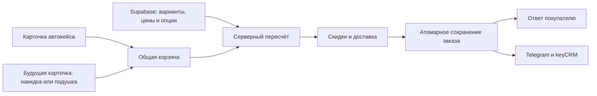

# Общая корзина для товаров с разными карточками

Дата: 2026-11-19. Статус: подготовлено к ревью; миграция в hosted Supabase не применена.

## Решение

У автокейсов есть размер, дизайн, марка и фиксация. Накидкам размер не нужен; у будущих подушек могут быть цвет и вышивка. Поэтому новые товары получают собственные варианты и опции, но используют существующие корзину, скидки, доставку, checkout и интеграции. Нынешние автокейсы не мигрируются в новую модель и сохраняют прежние цены и идентификаторы попыток оформления.

Это основа коммерческой части. Она не публикует реальные накидки/подушки и не создаёт универсальный редактор карточек. Разметка и конфигуратор будущего товара могут отличаться от автокейса.



## Данные

- `products`: название, slug, тип товара, ключ оформления, участие в скидке, статус.
- `product_variants`: SKU, цена, наличие, атрибуты (например `color`/`design`), необязательная ссылка на существующий `designs`, изображение R2, транспортные габариты и вес.
- `product_option_groups`: выбор из списка или текст; обязательность, ограничение длины, доплата.
- `product_option_choices`: варианты выбора и доплаты; необязательные ссылка на `brands` и отдельный SKU keyCRM для платного дополнения.

Строковые `product_type`, `layout_key` и `attributes` не требуют заранее фиксировать окончательную схему подушки в TypeScript. Ссылка на дизайн/марку позволяет использовать существующие справочники; цены и подписи конкретных опций задаются отдельно, без автоматического наследования доплаты автокейса.

По умолчанию записи черновые. Для опубликованного варианта обязательны SKU, цена и положительные транспортные параметры. Новые изображения допускаются только с `https://media.carzo.com.ua/`. В миграции нет наполнения каталога и клиентских данных.

RLS включён на четырёх таблицах. `anon` и `authenticated` не имеют доступа; серверный `service_role` получает только SELECT. Управление каталогом выполняет доверенный владелец БД, не браузер и не публичный endpoint. Секретный ключ остаётся на сервере.

## Контракт корзины

Старые строки автокейса принимаются без изменения. Новая строка содержит только выбор покупателя:

```ts
{
  productId: 'uuid',
  variantId: 'uuid',
  options: { logo: 'audi' },
  personalization: { embroidery: 'CARZO' },
  quantity: 1
}
```

Пример показывает доступные поля, а не окончательный набор опций какого-либо товара. Страница передаёт их в `useCart().addItem(...)`, затем открывает корзину или оформление. `options` и `personalization` могут быть пустыми.

Сервер проверяет принадлежность варианта товару, публикацию родительской записи и дочерних записей, наличие, обязательные поля, допустимые значения и длину текста. Цены, названия, скидки, SKU и габариты читаются из Supabase с `no-store`. Переданные браузером цены и неизвестные поля отклоняются. Недоступность каталога блокирует оформление соответствующего товара, без подстановки цен по умолчанию.

Группировка учитывает product/variant, все опции и персонализацию. Подушки с разной вышивкой остаются разными строками. Порядок ключей опций не меняет идентификатор строки. Эти же значения входят в fingerprint попытки checkout. Ключ localStorage остаётся `carzo:guest-cart:v1`; существующие корректные корзины продолжают читаться.

## Скидки и доставка

Применяется один общий уровень из существующего `discount_tiers` по количеству участвующих **единиц**, включая одинаковые товары. При действующих уровнях 2 → 200 ₴, 3 и больше → 500 ₴ это работает для любой комбинации автокейса, накидки и подушки. Это одна скидка на заказ, не на каждую строку. Не участвующие в скидке товары не увеличивают порог и не покрываются скидкой.

Клиентская скидка по телефону по-прежнему применяется после скидки за количество. Транспортная упаковка считается существующим алгоритмом: максимальные длина и ширина, сумма высоты и веса; допустимость отделения/поштомата проверяется на сервере. Размеры новых товаров должны быть фактическими размерами упаковки, а не размерами изделия. Тестовые габариты нельзя использовать как коммерческие.

## Заказ и интеграции

`order_items.catalog_item` хранит снимок продукта, варианта, SKU, атрибутов, выбранных подписей и текста, доплат и транспортного профиля. Изменение каталога позже не переписывает этот снимок. Не применимые к новым товарам поля автокейса остаются NULL/пустыми. У старых строк `catalog_item` равен NULL.

Миграция расширяет существующий `create_order_with_items` одним полем в INSERT. Сигнатура, advisory lock, проверка fingerprint, арифметики, атомарность и поведение повторного запроса сохраняются. Права EXECUTE остаются только у серверной роли. Для новых типов товаров допускается только Supabase writer: старый Directus writer не может молча отбросить параметры.

Telegram получает название и комплектацию каждой строки с экранированием пользовательского текста. keyCRM получает SKU варианта и комментарий с комплектацией. Доплата с отдельным `crm_sku` выделяется в отдельную позицию и вычитается из цены основной позиции; остальные доплаты остаются в цене варианта. Суммы проверяются прежними инвариантами. Заказ подтверждается после записи в БД; уведомления остаются фоновыми best-effort, повторный checkout не отправляет их повторно.

Это проверка построения сообщений и payload, а не подтверждение приёма будущего SKU реальным keyCRM. Его нужно сопоставить при запуске конкретного товара.

## Что нужно при запуске первого нового товара

1. После согласования применить `supabase/migrations/20261119140457_multi_product_commerce_foundation.sql` к нужной базе. Сначала проверить актуальные миграции и резервную копию. Код с пустым новым каталогом совместим со старыми автокейсами даже до этой миграции.
2. Согласовать и опубликовать код обычным процессом проекта. Дополнительный сервис, отдельный Supabase-проект и новые Vercel env для этой основы не нужны.
3. Создать отдельную карточку/конфигуратор конкретного товара и подключить её к общему `addItem`. Текущая ссылка из корзины `/products/{slug}` зарезервирована для будущих карточек: новый маршрут, SEO и навигацию необходимо реализовать при добавлении первого товара. `layout_key` пока хранит выбор будущего оформления, а не автоматически создаёт страницу.
4. Заполнить реальные название, цены, варианты, логотипы/доплаты, R2-медиа, согласованные SKU keyCRM и транспортные параметры. Опубликовать только полностью подготовленные позиции.
5. Проверить накидку/подушку в смешанном заказе с реальными правилами комплектации и согласованным тестом интеграций. Только затем открыть продажи.

Нынешние опции поддерживают список вариантов и текст с фиксированной доплатой. Если позже вышивка потребует загрузки файла, цены за символ или несовместимых комбинаций опций, эти конкретные правила добавляются отдельно. Для простых цвета, текста и логотипа переделывать корзину не потребуется.

При отзыве новой позиции её можно снять с публикации. Не удалять снимки уже созданных заказов и не выполнять обратный DROP миграции: старые данные и история должны сохраниться.

## Верификация

- `pnpm run typecheck`, `pnpm run lint`, `pnpm run build`.
- `pnpm run test:commerce`: смешанный пересчёт через mock PostgREST, браузерное хранение корзины, реальные checkout action и order writer с подменёнными внешними зависимостями, payload Telegram/keyCRM, fingerprint и старые сигнатуры.
- SQL-тест разворачивает всю цепочку миграций в PGlite (изолированный PostgreSQL/WASM), затем проверяет миграцию поверх существующего заказа, права/RLS, создание смешанного заказа от `service_role`, повтор и конфликт fingerprint, откат невалидного заказа. Docker и рабочая БД не нужны.
- Общий набор безопасных unit/mock-тестов исключает четыре live/env suite. Production build проверяется с локальным GET-only источником публичного контента.
- Браузерный прогон: настоящие CartProvider/CartDrawer с синтетическим ответом quote, widths 390/1440; смешанные параметры, восстановление, удаление и изменение количества. Реальные заказы и исходящие уведомления не создаются.

PGlite не воспроизводит сетевой PostgREST, несколько независимых PostgreSQL-сессий и Vercel runtime. В этой задаче hosted-миграция, новые SKU и живые внешние отправки не проверялись и не выполнялись.
